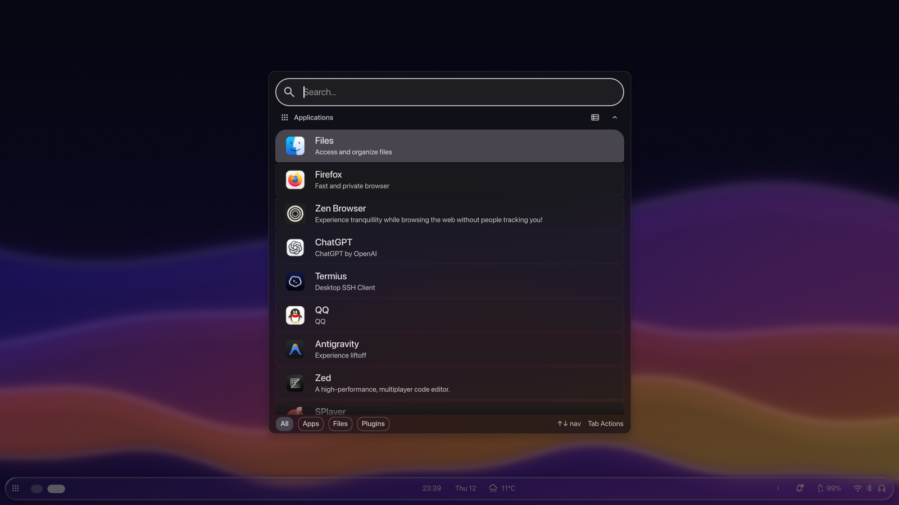
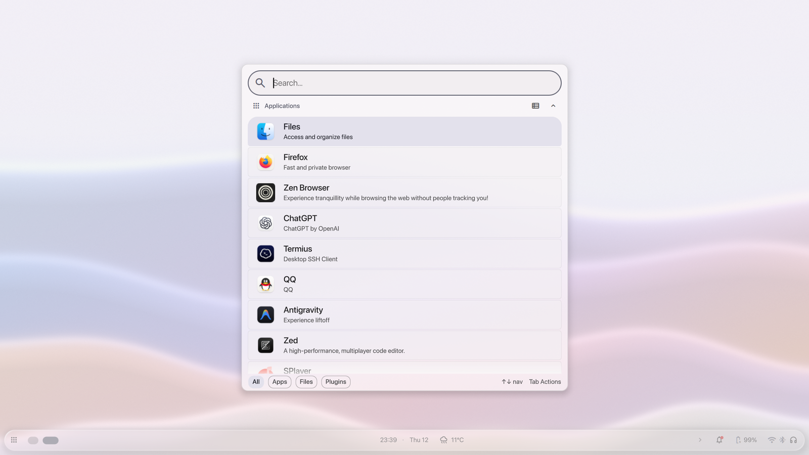

# 🍎 macOS Look for niri + DankMaterialShell

**Make your niri desktop feel like a Mac, in one command.**





## What you get

- 🫧 **A liquid glass bar.** A floating glass capsule that bends the wallpaper behind it, from the [Liquid Glass Bar](https://github.com/hua0512/dms-liquid-glass-bar) plugin.
- 🧊 **Frosted glass everywhere.** Stronger, softer blur on DMS's launcher, popups and notifications, and frosted terminals (kitty, Alacritty, Ghostty).
- 🔤 **San Francisco.** SF Pro as the system font, also used by websites that ask for Apple's system font.
- 🖼️ **Mac icons and cursor.** WhiteSur icons (light and dark) and the macOS cursor.
- 🪟 **Softer windows.** Rounder corners and roomier gaps between windows.
- 🔥 **A hot corner.** niri's top-left hot corner shows all your windows, like Mission Control (on unless you've turned it off).
- 🙈 **A tidy bar.** Tray icons tuck away behind a toggle, like Bartender, via the hiddenBar plugin.

Your keybinds, monitors, wallpaper and colours stay as they are, and your widgets stay where they are (hiddenBar is added next to them).

## Install

You need **niri 26.04 or newer** and **DankMaterialShell 2.1 or newer**. Then:

**1. Install the fonts, icons and cursor.** On Arch, from the AUR:

```sh
paru -S apple-fonts whitesur-icon-theme apple_cursor
```

On other distros, install SF Pro, the [WhiteSur icon theme](https://github.com/vinceliuice/WhiteSur-icon-theme) and the [macOS cursor](https://github.com/ful1e5/apple_cursor) however you like. Everything else works without them; you just keep your current font, icons or cursor.

**2. Run the installer:**

```sh
git clone https://github.com/hua0512/dms-macos-look
cd dms-macos-look
./install.sh
```

It backs up your settings first, applies the look, and restarts DMS once to load it. A few apps only pick up the new font and cursor after you restart them.

**Optional:** for the moving glass on video wallpapers, install `ffmpeg` and `grim`, then turn on **Live video glass** in **Settings → Plugins → Liquid Glass Bar**.

## Undo

```sh
./install.sh --uninstall
```

This undoes only what the installer changed. Anything else you've changed since, like keybinds or other settings, stays.

Running the installer again is safe: your original backup is kept, and your own glass settings are kept. It does re-apply the look's DMS settings (font, blur, corners, bar style) if you've changed them since.

## Make it yours

- **Glass:** frost, refraction, tint and more in **Settings → Plugins → Liquid Glass Bar**.
- **Blur and transparency:** **Settings → Interface style**.
- **Corners and gaps:** **Settings → System & integrations → niri**.
- **Hot corner:** set `hot-corners` in the `gestures` section of your niri config.

## What it changes

<details>
<summary>The details, for the curious</summary>

| Where | What |
|---|---|
| DMS settings | Font SF Pro; window corners 12 and gaps 8; blur 90 with soft outlines; popups 72% and layers 50% opaque; terminals 85% opaque; WhiteSur icons per light/dark mode; macOS cursor |
| DMS bar (first bar) | Clear background and widgets, no border, no goth corners, 8px edge spacing, docked (not island) with pill widgets; adds hiddenBar before the notification button |
| DMS plugins | Installs and enables Liquid Glass Bar and hiddenBar |
| `~/.config/niri/macos.kdl` | No compositor blur behind the glass bar, frosted terminals. Added to the end of `config.kdl` with one `include` line |
| `~/.config/fontconfig/conf.d/60-macos-fonts.conf` | SF Pro first for `sans-serif`, `system-ui`, `-apple-system` and `BlinkMacSystemFont` (ahead of the sans-serif fonts in your own `fonts.conf`; your CJK and emoji fonts are still used for characters SF Pro doesn't have) |
| GTK (gsettings) | Interface font SF Pro 11, macOS cursor |

The backup is kept in `~/.local/state/dms-macos-look/original`. Settings in DMS's `config.d` folder win over the look; the installer warns you if you have any.

</details>

## Troubleshooting

- **`apple-fonts` fails to build:** Apple sometimes updates the font downloads before the AUR package catches up. Try again in a few days, or check the package's AUR comments for a fix.
- **The bar isn't glass:** make sure the plugin is on: `dms ipc call plugins enable liquidGlassBar`.
- **niri didn't change:** the installer checks your config with `niri validate` and leaves niri alone if it doesn't pass (niri 26.04 or newer is needed). Run `niri validate` to see why. If your niri config is read-only (home-manager, for example), the installer tells you the one line to add yourself.

## License

[MIT](LICENSE). Apple, macOS and San Francisco are trademarks of Apple Inc. This project isn't affiliated with Apple and doesn't include any of Apple's fonts or artwork.
